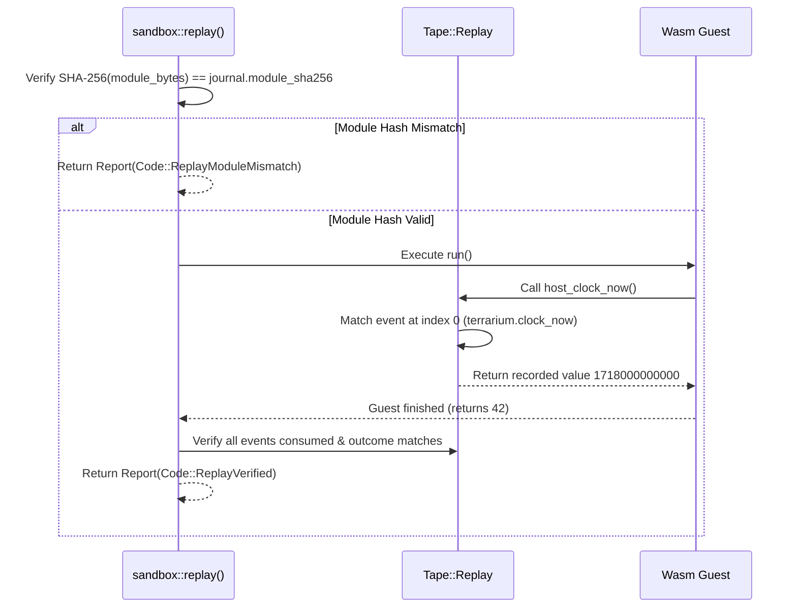

# Flight Recorder & Replay Engine

Terrarium provides deterministic reproducibility for WebAssembly execution. Since WebAssembly guest execution is single-threaded and isolated, non-determinism enters exclusively through host function calls (such as system clocks or random number generation). Terrarium records these interactions into a `Journal` and replays them to ensure strict equivalence.

---

## Journal Structure (`Journal`)

A `Journal` is a JSON-serialized flight record containing metadata, configuration context, and an ordered list of recorded events.

```json
{
  "format": 1,
  "module_sha256": "4a7f8b9...",
  "fuel_limit": 1000000,
  "max_output_bytes": 65536,
  "granted": ["stdout", "time", "random"],
  "events": [
    {
      "seq": 0,
      "import": "terrarium.clock_now",
      "value": 1718000000000
    },
    {
      "seq": 1,
      "import": "terrarium.rand_u64",
      "value": 88291029
    },
    {
      "seq": 2,
      "import": "terrarium.log",
      "text": "clock: 1718000000000, rand: 88291029"
    }
  ],
  "outcome": "returned",
  "result": 42
}
```

### Journal Metadata Fields

* `format`: Version identifier for the journal schema (currently `1`).
* `module_sha256`: Lowercase hex SHA-256 hash of the compiled guest module binary.
* `events`: Ordered list of `Event` objects representing host calls.
* `outcome`: Execution end state (`returned`, `trap`, `fuel_exhausted`).
* `result`: Optional 64-bit integer return value from the exported `run` function.

---

## Tape Engine (`Tape`)

The `Tape` state machine powers host function responses in both execution modes.

```mermaid
stateDiagram-v2
    [*] --> TapeRecord : sandbox::record()
    [*] --> TapeReplay : sandbox::replay()

    state TapeRecord {
        [*] --> AppendEvents : Guest calls host import
        AppendEvents --> AppendEvents : Record clock, rand, output
        AppendEvents --> SaveJournal : Guest returns or traps
    }

    state TapeReplay {
        [*] --> CheckSHA256 : Verify module binary matches journal hash
        CheckSHA256 --> ConsumeEvents : Guest calls host import
        ConsumeEvents --> ConsumeEvents : Match event sequence & inject recorded value
        ConsumeEvents --> VerifyOutcome : Guest returns or traps
    }
```
*Tape lifecycle and transition states during execution.*

### Tape Modes
1. **`Tape::Record`**: Host functions invoke live system functions (`SystemTime::now()`, `getrandom`), emit output to buffers, and append an `Event` to the recording tape.
2. **`Tape::Replay`**: Host functions check the next event in sequence from the tape. The import name is verified; if it matches, recorded inputs/values are injected back to the guest without invoking live system utilities.

---

## Divergence Detection (`Divergence`)

During replay, any deviation between the guest execution and the recorded journal produces a `Code::ReplayDivergence` report containing structured `Divergence` details.

| Divergence Kind | Description | Trigger Condition |
| :--- | :--- | :--- |
| `event_mismatch` | Sequential call mismatch | Guest invoked a different import than the journal recorded at sequence `seq` |
| `journal_exhausted` | Unrecorded host call | Guest attempted a host call after all recorded journal events were consumed |
| `journal_unconsumed` | Unconsumed journal events | Guest finished execution before all recorded journal events were consumed |
| `output_mismatch` | Output disparity | Text emitted via `log` differed from the recorded event text |
| `result_mismatch` | Return value disparity | Return value from `run` differed from recorded `result` |
| `outcome_mismatch` | Outcome disparity | Final status (e.g., `returned` vs `trap`) differed from recorded `outcome` |

---

## Safety Verification Flow


*Replay verification sequence and error boundaries.*
