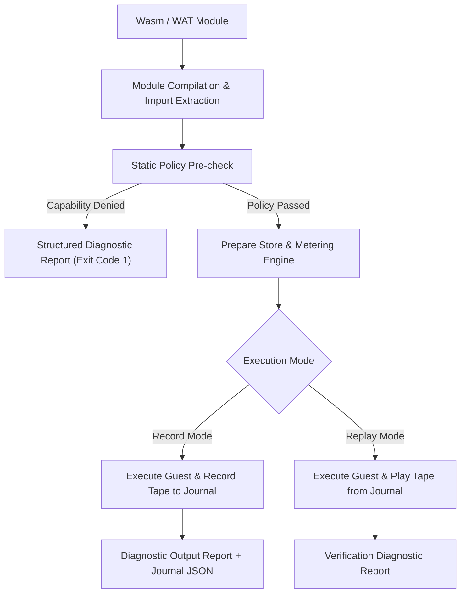
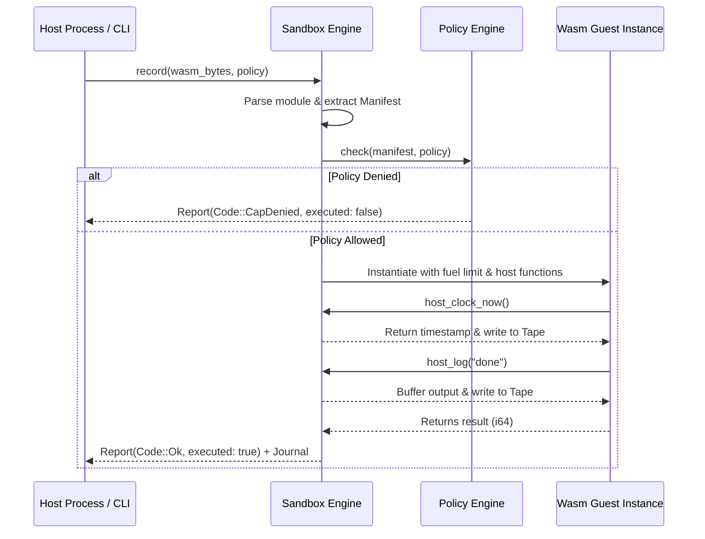

# Architecture Overview

Terrarium is a single-threaded WebAssembly execution environment designed for LLM agents and untrusted code execution. It guarantees safety and determinism through static pre-flight capability validation, metered execution budgets, and flight recording.

*Terrarium execution pipeline from module ingest to recording or verification output.*

---

## Key Architectural Principles

### 1. Zero WASI / Zero Unrestricted Imports
Terrarium explicitly avoids WASI (`wasi_snapshot_preview1`) or WASIX import namespaces. A guest module can only interact with the host through the explicit `terrarium` namespace functions (`log`, `clock_now`, `rand_u64`, `net_connect`). If a guest imports unknown functions or WASI modules, execution is rejected before instantiation with `CAP_UNKNOWN_IMPORT`.

### 2. Static Capability Manifest & Pre-flight Checks
Before any guest instruction runs, Terrarium inspects the WebAssembly import vector. The requested imports are mapped to required capabilities (`stdout`, `time`, `random`, `net`). If the policy denies any requested capability, execution stops immediately and produces a machine-readable `Report` containing actionable repair hints.

### 3. Metered Resource Budgets
Terrarium injects Wasmer middleware to meter WebAssembly operators (`fuel`). If a guest loop or computation exceeds the assigned fuel limit, execution traps safely with `Code::FuelExhausted`. Additionally, guest output emitted via `log` is subject to `max_output_bytes` limits.

### 4. Deterministic Flight Recording & Replay
Nondeterministic calls (`clock_now`, `rand_u64`) are intercepted by host functions:
- In **Record Mode**, real host values are returned to the guest and saved in sequential order in a `Journal`.
- In **Replay Mode**, host calls consume values from the journal. Mismatches in sequence, input parameters, or guest outputs trigger `Code::ReplayDivergence`.

---

## Execution Pipeline Mechanics

*Sequence diagram of a recorded execution pass in Terrarium.*

---

## Core Components Overview

| Component | Responsibility | Primary Types |
| :--- | :--- | :--- |
| `policy` | Capability registry, manifest extraction, policy evaluation, and diffing | `Policy`, `Manifest`, `HostSpec`, `Verdict` |
| `sandbox` | Wasmer embedding, engine initialization, host function wiring, record/replay execution | `Prepared`, `RunRecord`, `inspect`, `record`, `replay` |
| `journal` | Flight recording, event persistence, SHA-256 module verification, and tape management | `Journal`, `Event`, `Tape`, `Outcome` |
| `diagnostics` | Machine-readable status reporting, violation tracking, and divergence analysis | `Report`, `Code`, `Violation`, `Divergence` |
