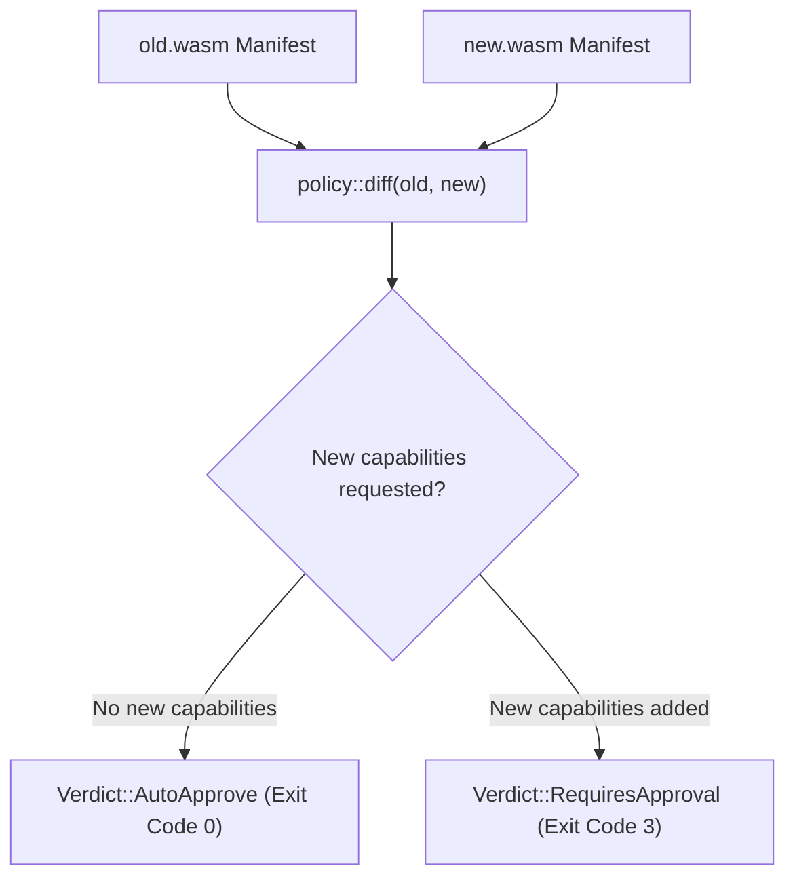

# Policy & Capabilities

Terrarium models host access using explicit capabilities rather than broad platform access. WebAssembly guests cannot access system calls, filesystems, or sockets directly. Every interaction requires an explicit import under the `terrarium` namespace.

---

## Host Specification Registry (`HOST_SPECS`)

Terrarium defines a static registry of host functions that guests can import. Anything outside this list does not exist and will be rejected as `Code::CapUnknownImport`.

| Import Name | Required Capability | Implemented? | Purpose | Repair Hint on Denial |
| :--- | :--- | :--- | :--- | :--- |
| `log` | `stdout` | Yes | Emits text output from guest memory | Return the value from `run` instead of logging it. |
| `clock_now` | `time` | Yes | Returns unix timestamp in milliseconds | Take timestamps as input data instead of reading a clock. |
| `rand_u64` | `random` | Yes | Returns a pseudorandom 64-bit integer | Pass a seed as input data and derive values from it. |
| `net_connect` | `net` | No | Statically declared stub for networking | Pass the data the guest needs as input instead of fetching it; this sandbox has no network. |

---

## Policy Configuration (`Policy`)

A `Policy` object dictates allowed capability names and execution budgets.

```toml
name = "demo"
allow = ["stdout", "time", "random"]

[budget]
fuel = 1000000
max_output_bytes = 65536
```

### Pre-defined Policies
- **`Policy::tier0()`**: A zero-capability policy (`allow` is empty) with default budgets. Pure WebAssembly modules with no imports run successfully under Tier 0, but any module requiring capabilities is rejected.
- **`Policy::load(path)`**: Parses a policy file from TOML format.

---

## Policy Verification (`policy::check`)

When a module is loaded, `sandbox::inspect` extracts its import list as a `Manifest`. `policy::check` evaluates the manifest against the target `Policy`:

1. **Unknown Imports:** Imports outside the `terrarium` namespace produce a `Violation` with `Code::CapUnknownImport`.
2. **Capability Denial:** Known imports whose required capability is missing from `policy.allow` produce a `Violation` with `Code::CapDenied`.
3. **Unimplemented Capabilities:** Declared imports that have no host implementation (such as `net_connect`) trigger violations explaining that the host does not implement the capability.

If any violations are present, execution is aborted *before* compiling or running guest code (`executed: false`).

---

## Capability Diffing (`policy::diff`)

Terrarium enables safe agent updates by diffing requested capabilities between two WebAssembly binaries (`old` vs `new`).


*Capability diffing decision flow for automated upgrade pipelines.*

### Diff Verdicts
* **`Verdict::AutoApprove`:** The updated module asks for a subset or equal set of rights compared to the old module.
* **`Verdict::RequiresApproval`:** The updated module requests new rights that were not present in the old module.

---

## Budget Metering (`Budget`)

Resource budgets prevent infinite loops and memory exhaustions:
* **Fuel Metering:** Uses Wasmer's operator metering middleware. Each Wasm instruction consumes fuel points. If fuel hits `0`, the engine halts guest execution and returns `Code::FuelExhausted`.
* **Output Limit:** Host logs accumulate output text up to `max_output_bytes`. Exceeding this limit causes a host runtime trap.
